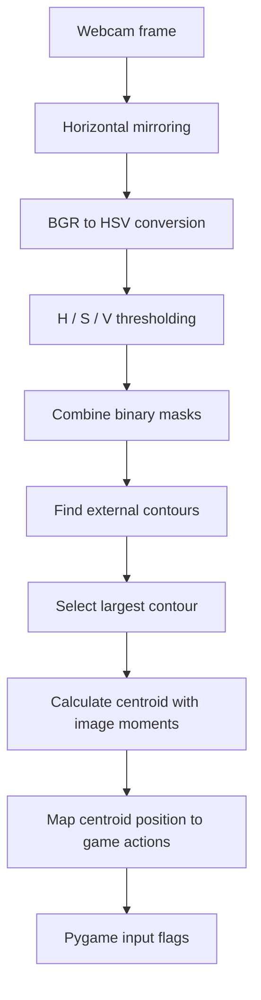

# Computer Vision — Game Interaction Projects

A collection of academic projects exploring **computer vision techniques applied to video game interaction**. The work uses Python and OpenCV to interpret webcam input and translate detected visual features into game controls.

**Course:** Introduction to Computer Vision  
**Academic year:** 2025/2026  
**Institution:** IPCA — Engineering and Game Development

## Contributors

### Project 1 — Game segmentation and tracking
- Anthony Frade
- Valezka Naia
- Carlos Pereira

### Project 2 — Object detection and tracking
- Anthony Frade
- Valezka Naia

The original games used as test environments retain their own authorship and asset credits. Refer to the included project reports and original game documentation for those acknowledgements.

## Projects

### Project 1 — Webcam control using HSV colour segmentation

This project explores colour-based segmentation and object tracking as an alternative input method for existing games.

The webcam image is mirrored and converted from BGR to HSV. Adjustable H, S and V thresholds are used to create a binary mask. External contours are extracted, the largest contour is selected, and its centroid is calculated using image moments. The centroid position is mapped to discrete game actions.

Two game integrations are included:

#### Space Invaders

The OpenCV module in `OpenCv.py` processes the webcam feed and updates control flags used by the Pygame Space Invaders game.

The detected object's horizontal position controls movement, while its vertical position is used to trigger shooting. OpenCV trackbars allow the HSV thresholds to be adjusted while the camera is running.

#### Super Mario

The `codigo_opencv.py` module applies the same general HSV segmentation approach to a Super Mario-style Pygame project. The detected object's position is mapped to left/right movement and jumping zones.

### Project 2 — Object detection and tracking

The accompanying report describes two alternative computer-vision approaches for webcam control of the Space Invaders game:

- **YOLOv8:** object detection using a trained object-detection model.
- **Circular Hough Transform (CHT):** circle detection using `cv2.HoughCircles`.

The report discusses image preprocessing, detection, tracking and mapping the detected object's position to game commands. It also documents experiments with Gaussian blur and circle selection based on distance from the previously tracked position.

**Source availability:** the supplied repository ZIP contains the Project 2 report documents, but does not contain the corresponding Project 2 implementation source files. The descriptions in this section are therefore based on the report, not on a code review of that implementation.

## Computer-vision pipeline

The Project 1 colour-segmentation pipeline can be summarised as follows:



## Technology stack

| Technology | Use |
|---|---|
| Python | Game and vision integration |
| OpenCV (`cv2`) | Camera capture, colour conversion, thresholding, contours, moments and Hough circle detection |
| NumPy | Image-array and mask operations |
| Pygame | Existing game runtime and input integration |
| YOLOv8 | Described in the Project 2 report for object detection |

## Repository structure

```text
Computer-Vision/
├── Project 1/
│   ├── Space_Invaders/
│   │   └── Python-Space-Invaders-Game-with-Pygame-main/
│   │       ├── OpenCv.py
│   │       ├── main.py
│   │       ├── game.py
│   │       ├── spaceship.py
│   │       ├── alien.py
│   │       ├── laser.py
│   │       └── obstacle.py
│   └── Super_Mario/
│       ├── codigo_opencv.py
│       ├── main.py
│       ├── classes/
│       ├── entities/
│       └── traits/
├── Project 1.pdf
├── Project 2.docx
└── README.md
```

## Running Project 1

The two game integrations are separate Python projects and should be run from their respective directories. The repository does not include one shared root-level Python environment or requirements file.

### Super Mario

A `requirements.txt` is included in the Super Mario directory:

```bash
cd "Project 1/Super_Mario"
python -m pip install -r requirements.txt
python main.py
```

The project uses a webcam for the OpenCV control module. Make sure a camera is connected and available to OpenCV.

### Space Invaders

The Space Invaders folder contains the Pygame game and `OpenCv.py`. Install the dependencies required by the game and OpenCV in your Python environment, then run the project's `main.py` from that folder.

The supplied archive does not include a dedicated `requirements.txt` for this subproject, so dependencies should be checked against the imports in its Python files.

## Controls and interaction

The webcam acts as the input device. The exact mapping depends on the game integration:

- **Space Invaders:** horizontal object position maps to left/right movement; vertical position is used to trigger shooting.
- **Super Mario:** the detected object's position is evaluated against screen regions to trigger left/right movement and jumping.

For the HSV approach, lighting conditions and the colour of the tracked object affect detection. The trackbars in the Space Invaders implementation allow threshold tuning during runtime.

## Reports and documentation

- `Project 1.pdf` — report for the segmentation and tracking project.
- `Project 2.docx` — report describing the YOLOv8 and Circular Hough Transform approaches.

## Scope and academic context

These projects were developed as coursework to explore practical computer-vision techniques and their integration with existing game loops. The repository includes both original integration code and third-party game code; credit for the original game projects and assets remains with their respective authors.
